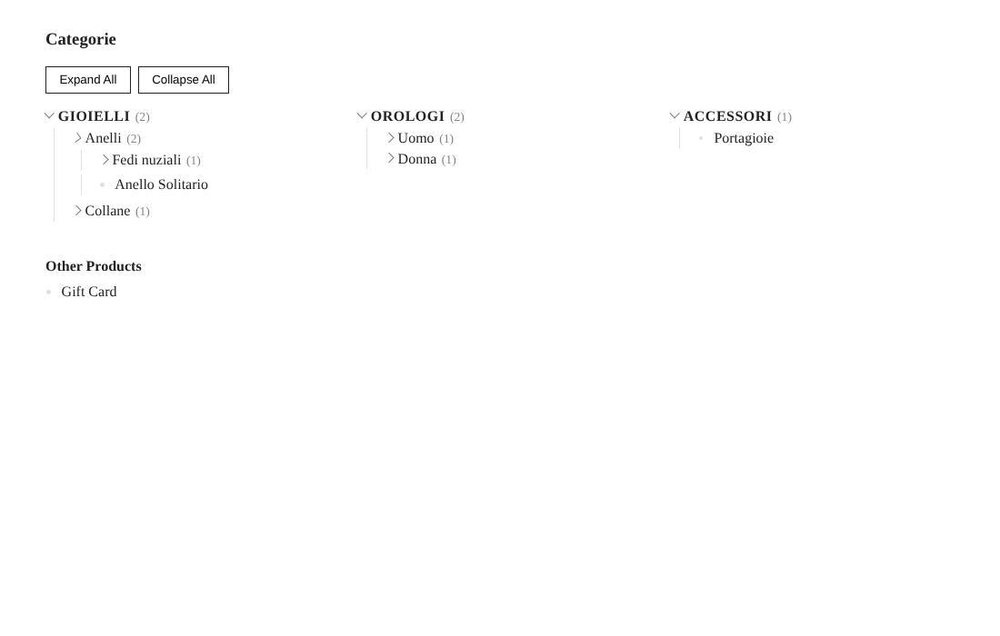

# Hierarchical HTML sitemap for Magento 2

`Delgraf_SeoHtmlSitemapTree` shows the categories of the [Swissup SEO HTML Sitemap](https://docs.swissuplabs.com/m2/extensions/seo-html-sitemap/) as a nested, collapsible tree, instead of a single flat list. If you want, the products can be shown inside their categories too.

It is an add-on: it does not change the Swissup module, and all Swissup settings keep working.



*Example with sample data and no theme styles. On your store the tree uses the fonts and colours of your theme.*

## The problem

Swissup SEO HTML Sitemap loads the categories of the store, up to the "Max Categories Depth" you set, and prints them all at the same level. Subcategories appear next to their parent categories, sorted only by name or position, so a customer cannot tell which category belongs to which. With many categories, the page becomes a long list that is hard to read.

## Features

- **Category tree:** each subcategory is shown inside its parent category, at any depth.
- **Same settings as Swissup:** maximum depth, sort order (name or position), number of columns, product stock and visibility filters all keep working.
- **Collapsible branches:** branches open and close with a click on the arrow, while a click on the name opens the category page. Uses the native HTML `<details>` and `<summary>` elements, without JavaScript libraries.
- **SEO-friendly:** closed branches stay in the page HTML, so search engines see all the links.
- **Levels open by default:** choose how many levels are open when the page loads.
- **"Expand All / Collapse All" buttons**, optional. Their small script goes through Magento's `SecureHtmlRenderer`, so it works with Content Security Policy.
- **Products inside their categories**, optional. Each product appears only in the deepest category it is assigned to, and the separate flat "Products" block is hidden. Products without a visible category can be listed under "Other Products".
- **Item counts** next to each branch, optional.
- **Columns:** the top-level categories are split across the number of columns set in Swissup, with fewer columns on tablets and phones.
- Works with Luma-based themes (such as Swissup Argento) and with Breeze: the styles are plain CSS.
- Translations: English, Italian, German, French and Spanish.
- No patches to `vendor/` and no database tables.

## Requirements

- Magento Open Source / Adobe Commerce 2.4.x or Mage-OS, PHP 8.2+
- Swissup SEO HTML Sitemap (`swissup/module-seo-html-sitemap`) 1.1 or later
- Written against `swissup/module-seo-html-sitemap` 1.1.23 on Magento 2.4.9 with the Swissup Argento Luxury theme

## Installation

Run all commands from the Magento root directory, as the user that owns the Magento files. Back up your code and database first, and try the module on a staging site before production.

### Option 1: Composer (recommended)

1. Put the store in maintenance mode (production stores only):

   ```bash
   bin/magento maintenance:enable
   ```

2. Download the module:

   ```bash
   composer require delgraf/module-seo-html-sitemap-tree
   ```

3. Enable the module and update Magento:

   ```bash
   bin/magento module:enable Delgraf_SeoHtmlSitemapTree
   bin/magento setup:upgrade
   ```

4. In production mode, compile the code and deploy the static content. The module has its own stylesheet and templates, so the static content must be deployed again:

   ```bash
   bin/magento setup:di:compile
   bin/magento setup:static-content:deploy
   ```

   Add your store locales to the last command if you normally list them, for example `bin/magento setup:static-content:deploy it_IT en_US`.

5. Clear the cache and leave maintenance mode:

   ```bash
   bin/magento cache:flush
   bin/magento maintenance:disable
   ```

### Option 2: Manual (app/code)

1. Download the latest version as a ZIP from the [Tags page](https://github.com/Delgraf/Magento2-SeoHtmlSitemapTree/tags) and extract it.
2. Copy its contents to `app/code/Delgraf/SeoHtmlSitemapTree/`, so that `registration.php` is at `app/code/Delgraf/SeoHtmlSitemapTree/registration.php`.
3. Run steps 1 and 3 to 5 of the Composer installation.

### Check the installation

1. Check that the module is enabled:

   ```bash
   bin/magento module:status Delgraf_SeoHtmlSitemapTree
   ```

2. Open the sitemap page on the storefront (by default `/sitemap`, or the "URL Path" set in the Swissup configuration).
3. The "Categories" block should show the categories as a tree, with an arrow next to the categories that have subcategories.
4. Click an arrow: the branch opens and closes. Click a category name: its page opens.

## Update

Read the [CHANGELOG](CHANGELOG.md) before updating, and back up your code and database. The module follows [Semantic Versioning](https://semver.org/): minor and patch versions (1.x) are backward compatible, while a new major version (2.0) may need changes on your side.

### Installed with Composer

1. Check the installed version and whether a newer one is available:

   ```bash
   composer show delgraf/module-seo-html-sitemap-tree
   composer outdated delgraf/module-seo-html-sitemap-tree
   ```

2. Put the store in maintenance mode (production stores only):

   ```bash
   bin/magento maintenance:enable
   ```

3. Update the package. This stays within the version range in your `composer.json` (for example `^1.0`), so it never jumps to a new major version:

   ```bash
   composer update delgraf/module-seo-html-sitemap-tree
   ```

   To move to a new major version, change the constraint on purpose, for example `composer require delgraf/module-seo-html-sitemap-tree:^2.0`.

4. Update Magento, recompile and deploy the static content (production mode), then clear the cache and leave maintenance mode:

   ```bash
   bin/magento setup:upgrade
   bin/magento setup:di:compile
   bin/magento setup:static-content:deploy
   bin/magento cache:flush
   bin/magento maintenance:disable
   ```

### Installed manually (app/code)

1. Download the new version as a ZIP from the [Tags page](https://github.com/Delgraf/Magento2-SeoHtmlSitemapTree/tags) and extract it.
2. Put the store in maintenance mode (step 2 above).
3. Delete the old files and copy in the new ones, so that no file from the old version is left behind:

   ```bash
   rm -rf app/code/Delgraf/SeoHtmlSitemapTree
   mkdir -p app/code/Delgraf/SeoHtmlSitemapTree
   cp -R /path/to/extracted/Magento2-SeoHtmlSitemapTree-x.y.z/. app/code/Delgraf/SeoHtmlSitemapTree/
   ```

4. Run step 4 above.

### After updating

- Check the version: `composer show delgraf/module-seo-html-sitemap-tree`, or the `CHANGELOG.md` in the module folder for a manual installation.
- Check the sitemap page as described in [Check the installation](#check-the-installation).

When you update Swissup SEO HTML Sitemap, check the sitemap page again. The module relies on the block names `seohtmlsitemap.categories` and `seohtmlsitemap.products` and on the public methods of the Swissup `Categories` and `Products` blocks.

## Configuration

Go to **Stores → Configuration → Swissup → HTML Sitemap → Hierarchical View (Delgraf)**. All settings can be set per website and per store view.

| Setting | Default | What it does |
|---|---|---|
| Enable Hierarchical View | Yes | Shows the categories as a tree. For categories, it takes priority over "Group Links by First Letter". |
| Collapsible Branches | Yes | Lets customers open and close the branches. With No, the whole tree is always open. |
| Levels Expanded by Default | 1 | Number of levels open when the page loads: 0 = all closed, 1 = only the top level open, 99 = everything open. |
| Show "Expand All / Collapse All" Buttons | Yes | Shows two buttons above the tree. |
| Show Products Inside Categories | No | Shows each product inside the deepest category it is assigned to, and hides the separate "Products" block. Needs "Show Products on Sitemap" = Yes in the Swissup settings. |
| List Products Without a Visible Category | Yes | Lists under "Other Products" the products that are not in any category shown in the tree. |
| Show Item Counts on Branches | Yes | Shows next to each branch the number of its direct subcategories and products. |

These Swissup settings, in the "Sitemap Content Settings" group of the same page, apply to the tree too:

- **Show Categories on Sitemap**: with No, the tree is not shown.
- **Max Categories Depth**: limits the depth of the tree (0 = all levels).
- **Sort Products and Categories By**: order of the categories within each branch, and of the products.
- **Number of Columns**: number of columns for the top-level categories.
- **Show Products on Sitemap** and **Show Out of Stock Products**: which products can appear in the tree.

Active categories without products are shown, as in the original Swissup sitemap.

## Customization

Copy a file into your theme to change it, keeping the same path under `Delgraf_SeoHtmlSitemapTree`:

| File | Content |
|---|---|
| `view/frontend/templates/tree.phtml` | Block container, buttons and "Other Products" list |
| `view/frontend/templates/tree/node.phtml` | A single category of the tree, rendered for every level |
| `view/frontend/templates/tree/products.phtml` | A list of product links |
| `view/frontend/web/css/sitemap-tree.css` | Styles |

For example, `app/design/frontend/<Vendor>/<theme>/Delgraf_SeoHtmlSitemapTree/templates/tree/node.phtml`.

For small changes to the look, you do not need to copy the stylesheet: override these CSS custom properties in your theme instead.

```css
.sitemap-tree {
    --sitemap-tree-indent: 1.25rem;              /* indent of each level */
    --sitemap-tree-guide: rgba(0, 0, 0, .12);    /* vertical guide lines and bullets */
    --sitemap-tree-muted: rgba(0, 0, 0, .5);     /* item counts */
    --sitemap-tree-marker-size: .45rem;          /* size of the arrow */
}
```

## How it works

- `view/frontend/layout/sitemap_index_index.xml` changes the template of the Swissup `seohtmlsitemap.categories` block to `tree.phtml` when "Enable Hierarchical View" is Yes, and passes it the `ViewModel\CategoryTree` view model. The module loads after `Swissup_SeoHtmlSitemap`, so this template replaces both `sitemap.phtml` and `grouped.phtml`.
- `Model\Tree\TreeBuilder` reads the categories from the collection of the Swissup block and links each category to its parent with `parent_id`. Names and URLs come from the Swissup block methods, so all Swissup filters and the sort order stay the same.
- When products are shown inside the categories, `TreeBuilder` reads the products from the collection of the Swissup `seohtmlsitemap.products` block, 500 at a time, and loads their category assignments. When a product is assigned to a category and to one of its subcategories, it is shown only in the subcategory.
- `Plugin\HideFlatProductsPlugin`, an `around` plugin on `Swissup\SeoHtmlSitemap\Block\Products::toHtml()`, returns an empty block when the products are already shown in the tree. The block stays in the layout, so its collection can still be used.
- The branches are `<details>` elements, opened or closed by the browser. Without JavaScript the tree still works; only the "Expand All / Collapse All" buttons need it.

## Troubleshooting

### The categories are still shown as a flat list

- Check that the module is enabled (`bin/magento module:status Delgraf_SeoHtmlSitemapTree`) and that "Enable Hierarchical View" is Yes for the store view you are looking at.
- Clear the cache: the sitemap page is stored in the full page cache.
- In production mode, check that `setup:di:compile` and `setup:static-content:deploy` were run after the installation.
- If your theme replaces the `seohtmlsitemap.categories` block, or sets its template in its own layout, the theme's layout may load after this module. Remove the theme's change, or set the template to `Delgraf_SeoHtmlSitemapTree::tree.phtml` in the theme.

### The tree has no styles

- Deploy the static content again and clear the cache.
- Check that the page loads `Delgraf_SeoHtmlSitemapTree/css/sitemap-tree.css` (browser developer tools, Network tab).

### Some products are missing from the tree

- Check "Show Products on Sitemap" and "Show Out of Stock Products" in the Swissup settings: the tree shows the same products as the Swissup "Products" block.
- A product assigned only to categories that are disabled, or deeper than "Max Categories Depth", is not in any category of the tree. Set "List Products Without a Visible Category" to Yes to list it under "Other Products".

### The sitemap page is slow with products inside the categories

With a large catalog, loading the category assignments of every product takes time on the first visit, before the page is stored in the full page cache. Set "Show Products Inside Categories" to No to show only the categories. If the problem remains, please [open an issue](https://github.com/Delgraf/Magento2-SeoHtmlSitemapTree/issues) with the number of products and categories.

## Uninstall

The module adds only configuration values, no database tables, so removing its code is all it takes. Without it, the Swissup sitemap goes back to its flat list.

To turn it off for a while, set "Enable Hierarchical View" to No, or disable the module (step 2) and skip removing the files.

### Installed with Composer

1. Put the store in maintenance mode (production stores only):

   ```bash
   bin/magento maintenance:enable
   ```

2. Disable the module:

   ```bash
   bin/magento module:disable Delgraf_SeoHtmlSitemapTree
   ```

3. Remove the package:

   ```bash
   composer remove delgraf/module-seo-html-sitemap-tree
   ```

4. Update Magento, recompile and deploy the static content (production mode), then clear the cache and leave maintenance mode:

   ```bash
   bin/magento setup:upgrade
   bin/magento setup:di:compile
   bin/magento setup:static-content:deploy
   bin/magento cache:flush
   bin/magento maintenance:disable
   ```

Alternatively, `bin/magento module:uninstall Delgraf_SeoHtmlSitemapTree` does steps 2 and 3 in one command, also for Composer installations only.

The settings saved in the admin stay in the `core_config_data` table, under paths that start with `seohtmlsitemap/tree_view/`. They do nothing without the module. To remove them, run this query on the Magento database (add your table prefix if you use one):

```sql
DELETE FROM core_config_data WHERE path LIKE 'seohtmlsitemap/tree_view/%';
```

### Installed manually (app/code)

1. Run steps 1 and 2 above.
2. Delete the module folder:

   ```bash
   rm -rf app/code/Delgraf/SeoHtmlSitemapTree
   ```

   If `app/code/Delgraf/` is now empty, you can delete it too.

3. Run step 4 above.

## License

[OSL-3.0](LICENSE.txt) (Open Software License 3.0)
